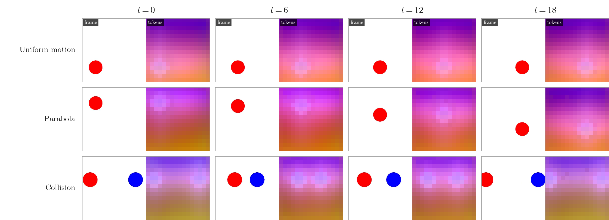
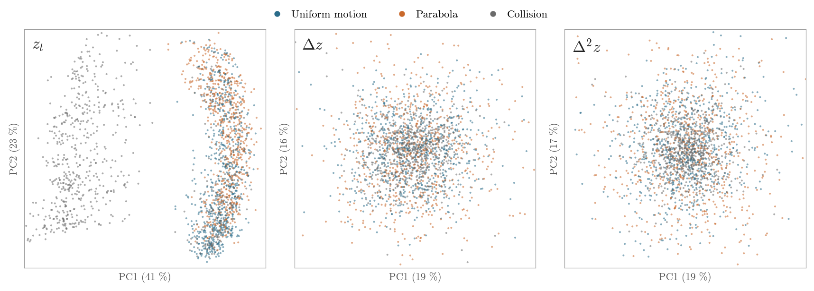
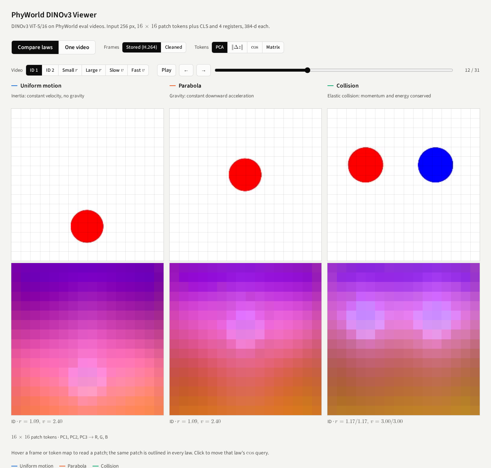

# DINOv3 tokens and physical laws

> This repository is a fork of [facebookresearch/dinov3](https://github.com/facebookresearch/dinov3) with one added experiment in [`physical_laws/`](physical_laws/). We pass PhyWorld videos through DINOv3 ViT-S/16 and test whether the tokens differ with the physical law that moves the objects. The DINOv3 code is unchanged. Its README is in [README_upstream.md](README_upstream.md).

<p align="center"></p>

Each pair shows a frame and its 16 × 16 DINOv3 patch tokens, coloured by the first three principal components of all tokens. One in-distribution video per law, frames 0, 6, 12 and 18 (10 frames per second).

- Results: [summary](#summary), [law separation](#law-separation), [token paths](#token-paths), [compression noise](#video-compression-noise)
- Interactive viewer: [`physical_laws/viewer/site`](physical_laws/viewer/site), see [Viewer](#viewer)
- How to run: [Reproduce](#reproduce)

## Summary

PhyWorld ([Kang et al., ICML 2025](https://phyworld.github.io)) has synthetic 2-D videos in which each scene follows one law. In uniform motion one ball moves at constant velocity without gravity. In parabola one ball is thrown sideways under gravity. In collision two balls collide head-on and perfectly elastically. We encode every frame with DINOv3 ViT-S/16 and compare the tokens of the three laws on all 467 in-distribution eval videos.

- A single frame does not tell the laws apart. A linear probe on the token of one frame separates uniform motion from parabola at 69–74 % (chance 50 %). On the H.264 frames as released it reaches 87–88 %, because the compression noise differs between the three datasets.
- The change between frames separates them. A probe on the first difference Δz separates uniform motion from parabola at 79 % with the CLS token and 90 % with the mean patch token.
- The second difference Δ²z, the term that gravity adds, is at chance level (53 %).
- A linear model of the token dynamics predicts its own law best. Fitted on uniform motion and tested on parabola, its error goes from 0.45 to 0.58 of the error of copying the last frame (CLS token). Fitted on parabola and tested on uniform motion, it goes from 0.47 to 0.76. Models fitted on one ball fail on two balls (17–36).
- Token paths zigzag for every law. The ratio ‖Δ²z‖ / ‖Δz‖ is 1.5–1.8 for tokens and 0 (uniform motion) or 0.06 (parabola) for the ball centre in pixels. Consecutive token changes point in partly opposite directions (cosine −0.5). Independent noise in every frame gives the same numbers (ratio √3 = 1.73, cosine −0.5). The curvature that gravity adds, 6 % per step, is small next to this.

## Data and model

| | |
|---|---|
| Videos | PhyWorld eval sets, Hugging Face [`magicr/phyworld`](https://huggingface.co/datasets/magicr/phyworld) (CC-BY-4.0). 256 × 256 px, 32 frames, 10 fps, H.264 |
| Laws | uniform motion 1,152 videos, parabola 1,056, collision 1,635. In distribution (ID) means radius 0.7–1.5 and velocity 1–4 (both balls for collision): 176, 176 and 115 videos |
| Mixed laws | combinatorial PHYRE scenes, out-of-template eval set (1,000 videos, 512 px, 50 frames). Used in the viewer only, as the first 32 frames at 256 px |
| Model | DINOv3 ViT-S/16, [`facebook/dinov3-vits16-pretrain-lvd1689m`](https://huggingface.co/facebook/dinov3-vits16-pretrain-lvd1689m) through Hugging Face transformers. Input 256 px. Output: CLS, 4 register and 16 × 16 patch tokens of 384 dimensions (last hidden state, after the final norm) |
| Frames | Stored: the H.264 frames as released. Cleaned: every pixel with R, G and B ≥ 235 set to 255, which removes the compression noise of 1–5 grey levels on the white background |

## Law separation

Samples are the frames t of the ID videos where frames t, t + 1 and t + 2 have every object fully inside the image: 4,366 for uniform motion, 3,685 for parabola and 2,475 for collision. Features are the state z<sub>t</sub>, the first difference Δz = z<sub>t+1</sub> − z<sub>t</sub> and the second difference Δ²z = z<sub>t+2</sub> − 2z<sub>t+1</sub> + z<sub>t</sub>, for the CLS token and for the mean of the 256 patch tokens.

<p align="center"></p>

2-D PCA of the mean patch token on cleaned frames, fitted without labels, up to 700 samples per law.

Linear probe: logistic regression on 64 principal components of the standardised feature, 5 folds split by video. Balanced accuracy on cleaned frames, stored frames in parentheses. Chance is 33 % for three laws and 50 % for two.

| Feature | CLS, 3 laws | CLS, uniform vs parabola | Mean patch, 3 laws | Mean patch, uniform vs parabola |
|---|---:|---:|---:|---:|
| State z<sub>t</sub> | 74.9 % (87.6 %) | 69.0 % (87.0 %) | 77.8 % (88.9 %) | 73.8 % (88.0 %) |
| First difference Δz | 57.8 % (50.3 %) | 78.7 % (65.1 %) | 76.2 % (67.8 %) | 89.9 % (84.3 %) |
| Second difference Δ²z | 35.7 % (34.2 %) | 52.7 % (50.9 %) | 36.1 % (34.9 %) | 53.0 % (52.0 %) |

Linear dynamics: ridge regression z<sub>t+2</sub> ≈ A [z<sub>t+1</sub>, z<sub>t</sub>] on 64 principal components, fitted on 70 % of the videos of one law and tested on the other 30 % of each law. The table gives the squared error divided by the error of copying z<sub>t+1</sub> (1 = as good as copying). Linear extrapolation is 2z<sub>t+1</sub> − z<sub>t</sub> without fitting. Cleaned frames.

| CLS token, trained on | Tested on uniform motion | Tested on parabola | Tested on collision |
|---|---:|---:|---:|
| Uniform motion | **0.47** | 0.58 | 31.02 |
| Parabola | 0.76 | **0.45** | 35.98 |
| Collision | 0.72 | 0.74 | **0.56** |
| Linear extrapolation | 3.09 | 2.94 | 2.45 |

| Mean patch token, trained on | Tested on uniform motion | Tested on parabola | Tested on collision |
|---|---:|---:|---:|
| Uniform motion | **0.47** | 0.64 | 20.32 |
| Parabola | 0.93 | **0.42** | 17.12 |
| Collision | 0.74 | 0.82 | **0.57** |
| Linear extrapolation | 3.01 | 2.70 | 2.28 |

Stored-frame numbers and the scatter points are in [`physical_laws/results/sep.json`](physical_laws/results/sep.json).

## Token paths

d1 is the change from one frame to the next and d2 the change of that change. For tokens they are Δz and Δ²z of the samples above (cleaned frames). For pixels they are computed from the ball centres in the PhyWorld position streams of the same ID videos, at steps where the ball is inside the image. A path at constant velocity has ‖d2‖ / ‖d1‖ = 0 and cos(d<sub>t</sub>, d<sub>t+1</sub>) = 1. Independent noise in every frame that dominates the change gives √3 = 1.73 and −0.5.

| | Uniform motion | Parabola | Collision |
|---|---:|---:|---:|
| ‖d2‖ / ‖d1‖, ball centre in pixels | 0.00 | 0.06 | 0.00 |
| ‖d2‖ / ‖d1‖, CLS token | 1.77 | 1.74 | 1.60 |
| ‖d2‖ / ‖d1‖, mean patch token | 1.75 | 1.68 | 1.54 |
| cos(d<sub>t</sub>, d<sub>t+1</sub>), ball centre in pixels | +1.00 | +1.00 | +0.92 |
| cos(d<sub>t</sub>, d<sub>t+1</sub>), CLS token | −0.51 | −0.47 | −0.26 |
| cos(d<sub>t</sub>, d<sub>t+1</sub>), mean patch token | −0.47 | −0.37 | −0.19 |

Ratios are medians over steps and cosines are means. The ball centre moves 6.0 px (uniform motion), 9.9 px (parabola) and 4.6 px (collision) per frame. Gravity adds 0.64 px per frame per frame. A patch is 16 px wide, so a ball moves less than one patch per frame and its tokens change with where the ball sits inside its patch. The numbers are in [`physical_laws/results/jitter.json`](physical_laws/results/jitter.json).

## Video compression noise

Patches at least one patch away from every object change by ‖Δz‖ = 1.13 per frame on stored frames and 0.81 on cleaned frames. Between blank frames after a ball has left the image the change is 0.36 on stored frames and 0 on cleaned frames. The PCA colours of every patch also shift when a ball leaves the image, which shows in the last frames of the parabola videos in the viewer.

## Viewer

<p align="center"></p>

[`physical_laws/viewer/site`](physical_laws/viewer/site) is a static page with its data (27 MB). Serve it and open http://localhost:8000:

```bash
python -m http.server -d physical_laws/viewer/site 8000
```

- Compare laws: uniform motion, parabola and collision side by side, each with the frame above its tokens, on one frame slider. The video buttons pick the same kind of video in every law (two ID videos, small and large radius, slow and fast velocity). Hovering outlines the same patch in every law. Below are per-frame charts and the law separation results.
- One video: the frame on the left and its tokens on the right, all 32 frames, and the CLS paths of 85 videos per scenario. This view also has the combinatorial PHYRE scenes.
- Token views: PCA colours, ‖Δz‖ to the previous frame, cosine similarity to a clicked patch, and a matrix of the 256 patch tokens (rows, raster order) by 32 basis coefficients (columns).
- Frames: switch between stored and cleaned frames.

## Reproduce

```bash
pip install -r physical_laws/requirements.txt
huggingface-cli login
python physical_laws/download_data.py --out data
python physical_laws/separation.py out/sep --src data/phyworld
python physical_laws/jitter.py out/sep/sep_features.npz physical_laws/results/jitter.json --src data/phyworld
python physical_laws/extract.py out/viewer --src data/phyworld
python physical_laws/build_viewer.py out/viewer out/sep/sep.json physical_laws/viewer/site --font data/fonts/latinmodern-math.otf
python physical_laws/make_figures.py out/viewer out/sep/sep.json physical_laws/assets
```

The DINOv3 weights on Hugging Face are gated. Accept the licence on the model page before `huggingface-cli login`. ffmpeg has to be on the PATH. On one RTX 3090, `separation.py` takes about 20 minutes (467 videos, stored and cleaned frames) and `extract.py` about 10 minutes. Both take `--limit` or `--bg` for a quick test run.

| File | Content |
|---|---|
| `physical_laws/download_data.py` | PhyWorld eval sets (about 80 MB) and the Latin Modern Math font used by the viewer |
| `physical_laws/separation.py` | features of all ID videos, PCA, linear probes, cross-law dynamics → `sep.json`, `sep_features.npz` |
| `physical_laws/jitter.py` | ‖d2‖ / ‖d1‖ and cos(d<sub>t</sub>, d<sub>t+1</sub>) for tokens and pixels → `jitter.json` |
| `physical_laws/extract.py` | tokens of the 24 videos shown in the viewer and the CLS paths of 85 videos per scenario |
| `physical_laws/build_viewer.py`, `physical_laws/viewer/viewer_src.html` | static viewer |
| `physical_laws/make_figures.py` | figures in `physical_laws/assets` |
| `physical_laws/results/` | `sep.json`, `jitter.json` |

## Limits

- One encoder (ViT-S/16), linear probes and linear dynamics only. The zigzag depends on where the ball sits inside its patch, which is a function of the state, so a nonlinear model can use it.
- Uniform motion starts anywhere in the image and parabola in the upper third, so the state probe also sees the height of the ball.
- Only the eval sets are used, not the PhyWorld training sets.
